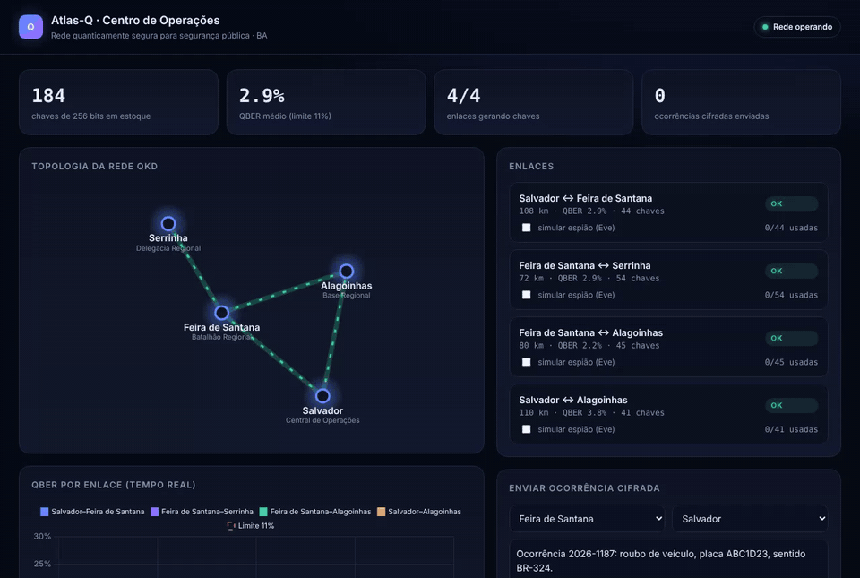
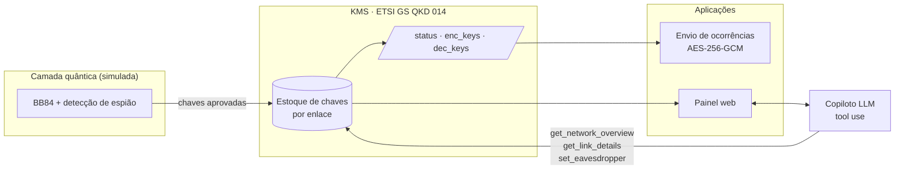
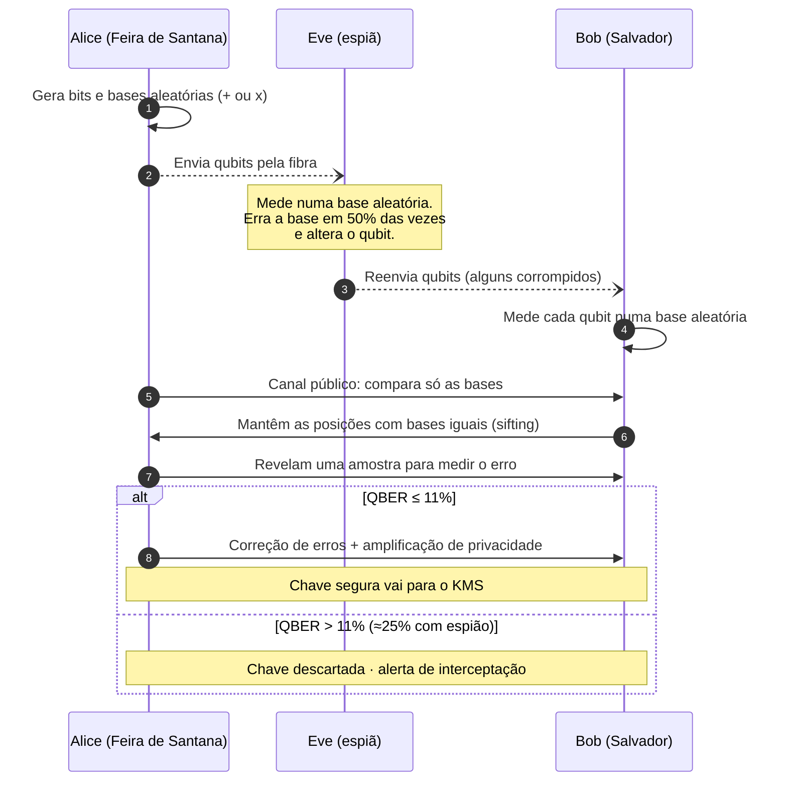
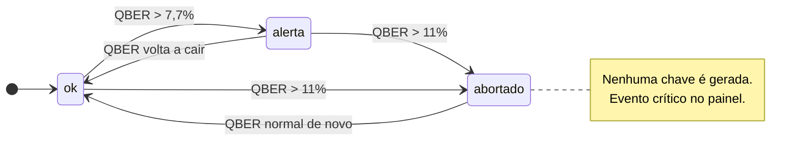
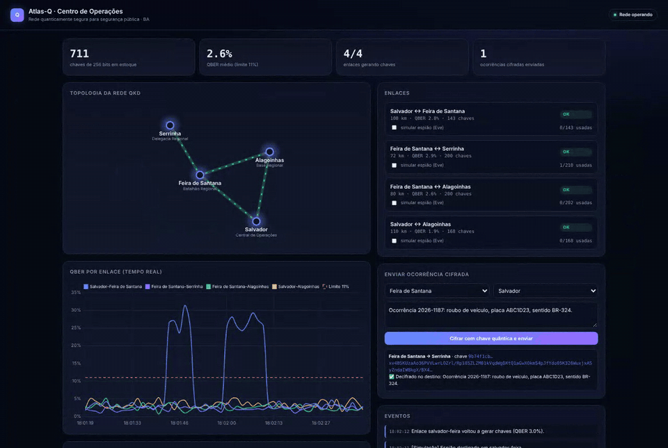
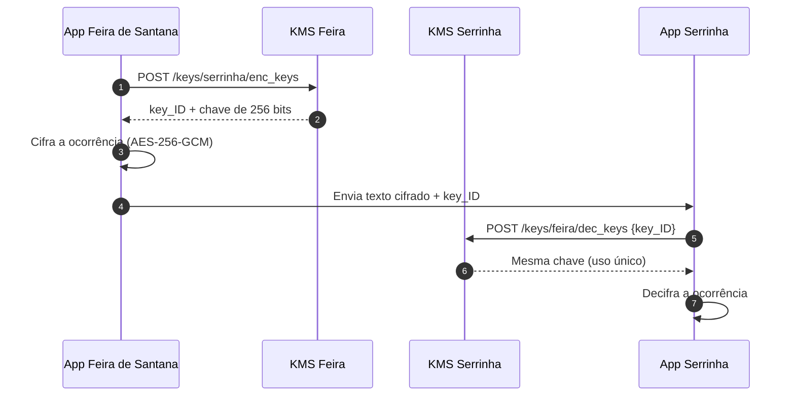
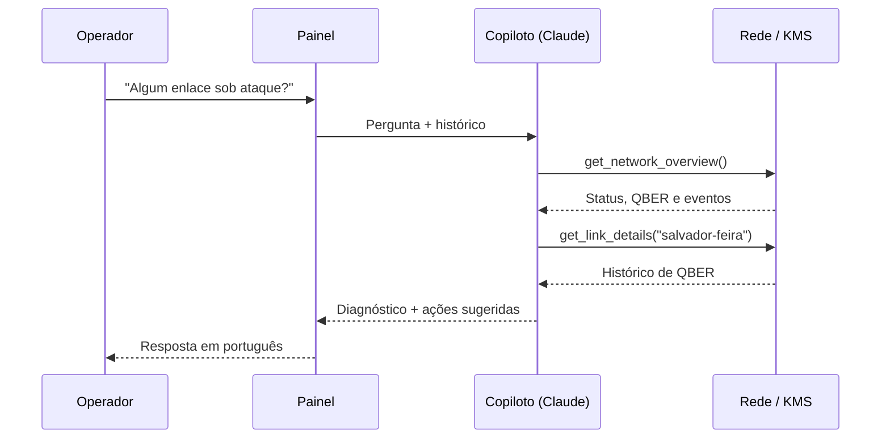
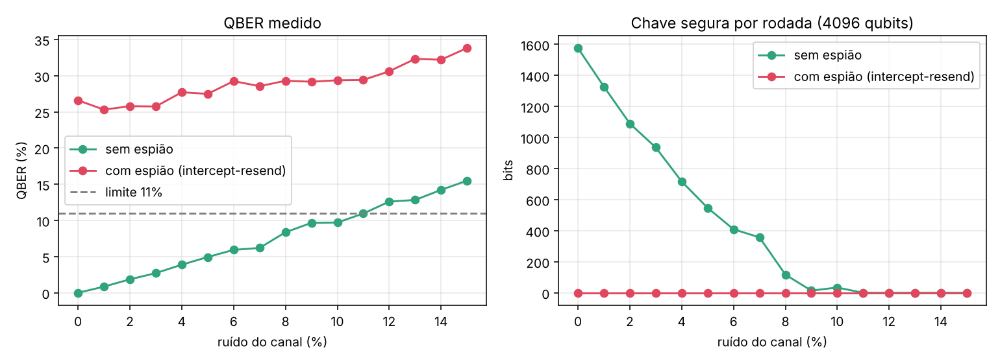

# Atlas-Q · Rede quanticamente segura com copiloto de IA

[](https://github.com/rogeriocerqueira/Atlas-Q/actions/workflows/ci.yml)


🔗 **[Ver demo ao vivo](https://atlas-q-ak9o.onrender.com)** · hospedado no plano gratuito do Render: o primeiro acesso pode levar até 50 segundos para "acordar".

> Simulação de uma rede de **Distribuição Quântica de Chaves (QKD)** que protege a troca de ocorrências entre unidades de segurança pública na Bahia, com **KMS no padrão ETSI GS QKD 014** e um **copiloto de operações com LLM** que monitora a rede e explica incidentes em linguagem natural.



<sub>Um espião é ligado no enlace Salvador ↔ Feira de Santana: o QBER passa do limite de 11%, o enlace aborta e o painel entra em incidente. Ao desligar, a geração de chaves volta ao normal.</sub>

## Por que este projeto existe

Computadores quânticos vão quebrar a criptografia de chave pública usada hoje (RSA, ECC). Dados sensíveis, como ocorrências policiais, já podem ser interceptados agora e decifrados no futuro ("harvest now, decrypt later").

A QKD resolve a troca de chaves usando física: se alguém tentar medir os qubits no caminho, a taxa de erro (QBER) sobe e a chave é descartada. O Atlas-Q simula esse cenário de ponta a ponta:

1. **Camada quântica (simulada):** cada enlace roda o protocolo BB84 continuamente.
2. **Camada de gestão de chaves (KMS):** as chaves aprovadas vão para um estoque e são entregues às aplicações pela API padrão ETSI GS QKD 014.
3. **Camada de aplicação:** unidades enviam ocorrências cifradas com AES-256-GCM usando chaves quânticas.
4. **Camada de operações:** um copiloto com LLM (Claude) consulta o estado da rede por ferramentas e responde ao operador.

## Arquitetura



| Módulo | Responsabilidade |
|---|---|
| `app/bb84.py` | Protocolo BB84: sifting, estimativa de QBER, correção de erros e amplificação de privacidade |
| `app/network.py` | Nós, enlaces, geração contínua de chaves e log de eventos |
| `app/etsi.py` | API REST de entrega de chaves no padrão ETSI GS QKD 014 |
| `app/messaging.py` | Aplicação de demonstração: ocorrências cifradas entre unidades |
| `app/copilot.py` | Copiloto com LLM e ferramentas (modo offline sem chave de API) |
| `static/index.html` | Painel de operações em tempo real |
| `scripts/experimento_qber.py` | Experimento de QBER × ruído, com e sem espião |

## Como o BB84 detecta o espião



## Estados de um enlace



## Como rodar

**Com Docker**

```bash
cp .env.example .env          # opcional: coloque sua ANTHROPIC_API_KEY
docker compose up --build
```

**Sem Docker**

```bash
python -m venv .venv && source .venv/bin/activate
pip install -r requirements.txt
uvicorn app.main:app --reload
```

Abra http://localhost:8000 para o painel e http://localhost:8000/docs para a documentação interativa da API.

Sem `ANTHROPIC_API_KEY`, o copiloto funciona em **modo offline**, com regras simples. Com a chave, ele usa o Claude com chamadas de ferramenta.

## Demonstração



<sub>Uma ocorrência é cifrada com chave quântica em Feira de Santana e decifrada em Serrinha. Em seguida o copiloto responde se há enlace sob ataque.</sub>

1. Abra o painel e veja os quatro enlaces gerando chaves (QBER entre 2% e 5%).
2. Marque **simular espião (Eve)** no enlace Salvador ↔ Feira de Santana.
3. O QBER salta para cerca de 25%, o enlace passa para **ABORTADO** e as chaves param de ser geradas.
4. Pergunte ao copiloto: *"Algum enlace sob ataque? O que devo fazer?"*
5. Envie uma ocorrência de Feira de Santana para Serrinha e veja o texto cifrado e o texto decifrado no destino.

> O GIF mostra o copiloto em modo offline (regras). Com `ANTHROPIC_API_KEY` configurada, as respostas vêm do Claude.

**Sobre a demo ao vivo:** ela roda com o copiloto em modo offline, para não expor uma chave de API paga. O estado da rede é compartilhado entre todos os visitantes: se alguém ligar o espião, todo mundo que estiver com o painel aberto vê o incidente. A documentação interativa da API fica em [/docs](https://atlas-q-ak9o.onrender.com/docs).

## API ETSI GS QKD 014

A chave nunca viaja junto com a mensagem: só o `key_ID`. Cada lado busca a chave no próprio KMS.



```bash
# Estoque de chaves entre Feira de Santana (master) e Salvador (slave)
curl localhost:8000/api/v1/keys/salvador/status -H "X-SAE-ID: feira"

# Feira de Santana pede 2 chaves para falar com Salvador
curl -X POST localhost:8000/api/v1/keys/salvador/enc_keys \
     -H "X-SAE-ID: feira" -H "Content-Type: application/json" -d '{"number": 2}'

# Salvador recupera as mesmas chaves pelos key_IDs
curl -X POST localhost:8000/api/v1/keys/feira/dec_keys \
     -H "X-SAE-ID: salvador" -H "Content-Type: application/json" \
     -d '{"key_IDs": [{"key_ID": "<id retornado acima>"}]}'
```

## Copiloto com LLM (tool use)

O modelo não inventa o estado da rede: ele chama ferramentas que leem os dados reais antes de responder.



| Ferramenta | O que faz |
|---|---|
| `get_network_overview` | Estado de todos os nós e enlaces, QBER e últimos eventos |
| `get_link_details` | Histórico de QBER e contadores de um enlace |
| `set_eavesdropper` | Liga ou desliga um espião simulado, para treino |

## Experimento: QBER × ruído

```bash
python -m scripts.experimento_qber
```



- **Sem espião:** o QBER acompanha o ruído do canal. A chave segura diminui conforme o ruído cresce e zera perto do limite de 11%.
- **Com espião (intercept-resend):** o QBER fica em torno de 25% mesmo sem ruído, como prevê a teoria (Eve erra a base em 50% dos casos, e metade dessas medições gera erro). O protocolo aborta sempre: o ataque é sempre detectado.

## Testes

```bash
pytest -q          # testes
ruff check .       # lint
ruff format .      # formatação
```

Testes e lint rodam automaticamente no GitHub Actions a cada push, e cada push na `main` atualiza a demo no Render.

Os testes cobrem: geração de chave sem espião, aborto com espião, enc_keys e dec_keys devolvendo a mesma chave, chave de uso único, envio de ocorrência cifrada e detecção de incidente pelo copiloto.

## Limitações e próximos passos

Este é um projeto de estudo. A camada física é simulada e algumas partes estão simplificadas:

- [ ] **TLS mútuo** entre SAE e KMS (hoje a identidade vem do cabeçalho `X-SAE-ID`)
- [ ] **Roteamento de chaves por nós confiáveis** (trusted nodes), para unidades sem enlace direto
- [ ] Correção de erros real (Cascade ou LDPC) e hashing universal com matriz de Toeplitz
- [ ] Eventos de chave publicados em **Kafka**
- [ ] KMS reescrito em **Kotlin + Spring Boot**
- [ ] Criptografia pós-quântica (ML-KEM) como alternativa híbrida

## Referências

- Bennett, C. H.; Brassard, G. *Quantum cryptography: Public key distribution and coin tossing* (1984)
- ETSI GS QKD 014 — *Protocol and data format of REST-based key delivery API*

## Autor

**Rogério dos Santos Cerqueira** · Engenharia de Computação (UEFS) · [Lattes](https://lattes.cnpq.br/0254977009739288) · [LinkedIn](https://www.linkedin.com/rogeriocerqueirauefs) · [GitHub](https://github.com/rogeriocerqueira)